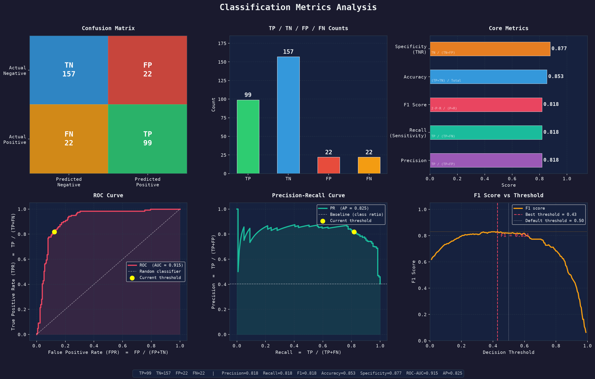

# VoltC

Digital twin platform for energy waste monitoring in commercial facilities. VoltC uses computer vision and automated rules to detect room occupancy, monitor power draw, calculate wasted electricity costs, and create actionable facility plans.



## Core Capabilities

1. Vision based occupancy detection using YOLOv8
2. Interactive digital twin floor map
3. WebRTC camera integration for live video analysis
4. Real time energy waste and tariff calculation
5. Carbon emissions analytics in kilograms of CO2
6. Automated facility reports powered by generative AI

## How to Run

1. Navigate to the project folder

```bash
cd VoltC
```

2. Install dependencies

```bash
pip install streamlit opencv_python_headless streamlit_webrtc ultralytics av torch torchvision pandas plotly scikit_learn google_genai groq python_dotenv
```

3. Launch the dashboard

```bash
streamlit run app.py
```
